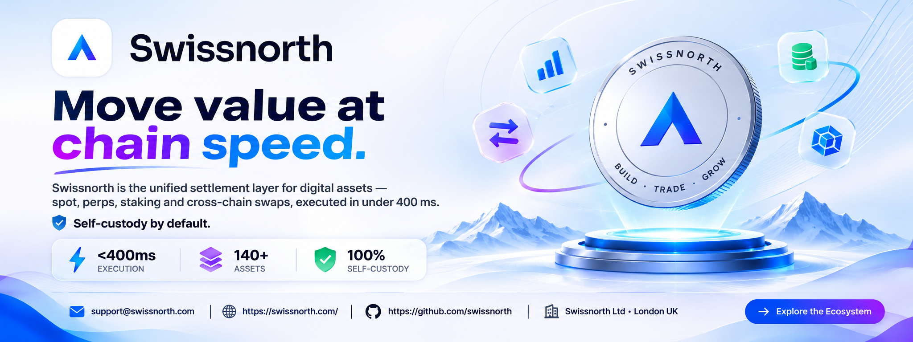

  

  <h1>Swissnorth Ltd</h1>
  <h3>Move Value at Chain Speed.</h3>
  
<strong>The Unified Settlement Layer for Digital Assets</strong>

  
Spot Trading · Perpetuals · Staking · Cross-Chain Swaps

  

    
    
    
  

  
<em>London, United Kingdom</em>

---

## Overview

Swissnorth is a digital asset platform designed to bring trading, settlement, and market intelligence together in one unified experience.

From spot trading and perpetuals to staking and cross-chain swaps, Swissnorth aims to simplify access to the on-chain economy through a unified settlement engine, advanced market visualization, and a self-custody-first approach.

The platform combines real-time order-book analysis, liquidity visualization, volume insights, and configurable trading tools to help users better understand market activity.

**Key platform highlights**

- Unified access to supported digital asset services.
- Settlement execution advertised at under 400 ms.
- Real-time liquidity and order-flow visualization.
- EVM and Solana wallet connectivity.
- Portfolio, risk, and profit-and-loss visibility.
- Configurable market analysis and trading workflows.

## Platform Features

<table>
  <tr>
    <td width="50%" valign="top">
      <h3>Liquidity Heatmap</h3>
      Visualize resting limit orders across price levels as liquidity appears, moves, and disappears.
      <ul>
        <li>Identify potential support and resistance.</li>
        <li>Monitor significant liquidity changes.</li>
        <li>Analyze potential breakout and reversal areas.</li>
      </ul>
    </td>
    <td width="50%" valign="top">
      <h3>Volume Bubbles</h3>
      Understand executed volume and buying or selling activity as it happens.
      <ul>
        <li>Visualize volume at individual prices.</li>
        <li>Identify buying and selling imbalances.</li>
        <li>Monitor possible momentum exhaustion.</li>
      </ul>
    </td>
  </tr>
  <tr>
    <td width="50%" valign="top">
      <h3>Best Bid &amp; Offer</h3>
      Track how incoming volume interacts with the bid-ask spread.
      <ul>
        <li>Examine potential absorption and exhaustion.</li>
        <li>Monitor short-term order-flow changes.</li>
        <li>Gain context beyond candlestick charts.</li>
      </ul>
    </td>
    <td width="50%" valign="top">
      <h3>Current Order Book</h3>
      Explore resting liquidity across the depth of market.
      <ul>
        <li>View complete market depth (DOM).</li>
        <li>Customize columns to suit your workflow.</li>
        <li>Study liquidity distribution across prices.</li>
      </ul>
    </td>
  </tr>
  <tr>
    <td width="50%" valign="top">
      <h3>Nanosecond Zoom</h3>
      Drill into market microstructure with highly granular visualization.
      <ul>
        <li>Inspect volume, liquidity, and bid/offer updates.</li>
        <li>Review detailed market activity.</li>
        <li>Support granular trade analysis.</li>
      </ul>
    </td>
    <td width="50%" valign="top">
      <h3>Record &amp; Replay</h3>
      Review historical market sessions and revisit trading decisions.
      <ul>
        <li>Examine market activity tick by tick.</li>
        <li>Review trading decisions.</li>
        <li>Support strategy analysis.</li>
      </ul>
    </td>
  </tr>
</table>

## Get Started in Three Steps

From wallet connection to your first trade, Swissnorth aims to make onboarding straightforward.

### 01 · Connect

Link a supported EVM or Solana wallet, or create a Swissnorth smart account. The described onboarding flow is designed to avoid lengthy forms and preserve user control of assets.

### 02 · Fund

Bring supported assets from another chain through the platform's bridging and routing flow.

### 03 · Trade Everything

Access supported spot trading, perpetuals, staking, and swaps from a unified balance experience, with portfolio, risk, and PnL information in one view.

## One Account for the On-Chain Economy

Swissnorth brings multiple digital asset services into one platform experience.

| Service | Description |
| --- | --- |
| Spot Trading | Access supported digital asset markets. |
| Perpetuals | Explore supported perpetual trading markets. |
| Staking | Access available staking functionality. |
| Cross-Chain Swaps | Route supported assets across compatible networks. |
| Market Analytics | Analyze liquidity, order-book depth, and order flow. |
| Portfolio Overview | Review available portfolio, risk, and PnL information. |
| Record & Replay | Revisit market sessions and examine trading activity. |

Availability depends on supported networks, data providers, product configuration, and applicable terms.

## Security &amp; User Control

Swissnorth describes its security architecture around user control, verifiability, and granular permissions.

<table>
  <tr>
    <td width="50%" valign="top">
      <h3>MPC Key Management</h3>
      Private-key material is split across independent parties so that a single machine cannot reconstruct the signing key.
    </td>
    <td width="50%" valign="top">
      <h3>On-Chain Proof of Reserves</h3>
      The platform describes balances and matches as verifiable on-chain. Consult official documentation for verification methods and scope.
    </td>
  </tr>
  <tr>
    <td width="50%" valign="top">
      <h3>Open, Auditable Contracts</h3>
      Swissnorth describes its core contracts as open source and reviewed, with a bug-bounty program. Refer to official resources for repositories, audits, and program terms.
    </td>
    <td width="50%" valign="top">
      <h3>Granular Session Keys</h3>
      Scope session permissions by device and action, with the ability to revoke sessions.
    </td>
  </tr>
</table>

### Security Principles

- **User control:** A self-custody-first approach to asset management.
- **Verifiability:** On-chain verification capabilities as described by the platform.
- **Permission management:** Granular session permissions and revocation.
- **Contract transparency:** Open-source contract availability as described by Swissnorth.

For implementation details, security audits, and current security status, consult the company's official documentation.

## Why Swissnorth?

- **Unified experience:** Multiple digital asset services in one platform.
- **Market visibility:** Tools for examining liquidity and order-flow behavior.
- **Detailed analysis:** Granular market data and replay capabilities.
- **Flexible workflows:** Configurable charts, indicators, columns, and layouts.
- **User control:** A platform designed around self-custody principles.

## Frequently Asked Questions

  
<strong>What is Swissnorth?</strong>

  Swissnorth is a digital asset platform that combines trading services and market-analysis tools in a unified experience.

  
<strong>What services does Swissnorth offer?</strong>

  Depending on availability, the platform offers spot trading, perpetuals, staking, cross-chain swaps, market analytics, and session replay tools.

  
<strong>How do I get started?</strong>

  Connect a supported wallet or create a smart account, fund it using a supported route, and access the available trading services.

  
<strong>Which wallets are supported?</strong>

  The described onboarding flow supports EVM and Solana wallets, along with a Swissnorth smart-account option. Check the official website for current compatibility.

  
<strong>How much does Swissnorth cost?</strong>

  Swissnorth describes a free starting option and paid packages with additional tools or market-data choices. Visit the official website for current pricing.

  
<strong>What is a liquidity heatmap?</strong>

  A liquidity heatmap visualizes resting limit orders over time, helping users see where liquidity appears, moves, or disappears.

  
<strong>Can a liquidity heatmap predict market movements?</strong>

  No. A heatmap can reveal areas of interest and changing order-book behavior, but it cannot guarantee future prices or trading outcomes.

  
<strong>What are Volume Bubbles?</strong>

  Volume Bubbles visualize executed trading volume at different price levels to help users analyze buying and selling activity.

  
<strong>Can I customize the platform?</strong>

  Supported charts, indicators, columns, layouts, and add-ons can be configured to fit your workflow.

  
<strong>Can I review my trading activity?</strong>

  Swissnorth describes Record &amp; Replay functionality for revisiting market sessions and examining activity tick by tick.

  
<strong>How does Swissnorth approach security?</strong>

  Its described security features include MPC key management, on-chain verification, auditable contracts, and granular session keys. Review official security documentation for implementation details.

  
<strong>Where can I get support?</strong>

  Visit <a href="https://swissnorth.com/">swissnorth.com</a> or email <a href="mailto:support@swissnorth.com">support@swissnorth.com</a>.

## Company Information

| Detail | Information |
| --- | --- |
| Company | Swissnorth Ltd |
| Location | London, United Kingdom |
| Website | [swissnorth.com](https://swissnorth.com/) |
| GitHub | [github.com/swissnorth](https://github.com/swissnorth) |
| Support Email | [support@swissnorth.com](mailto:support@swissnorth.com) |

## Mission, Vision &amp; Values

### Mission

Swissnorth's stated mission is to make access to financial markets more accessible through innovative trading solutions, with an emphasis on transparent, secure, and efficient services for users with different experience levels.

### Vision

Swissnorth aims to help make digital asset markets more connected and understandable through technology development, improved usability, and a unified on-chain experience.

### Values

- **Integrity:** Communicate platform functionality and terms responsibly.
- **Transparency:** Make relevant information and risk disclosures accessible.
- **Innovation:** Develop tools for market analysis and digital asset services.
- **User Focus:** Design around practical trading workflows.
- **Continuous Improvement:** Evolve platform capabilities with technology and market needs.

## Trading Risk &amp; Policy

Trading financial instruments and digital assets involves substantial risk. Users should understand the risks associated with their chosen markets, products, and strategies before participating.

- Users are responsible for their trading decisions, including order placement and automated trading programs, subject to applicable agreements and law.
- Fees, inactivity provisions, account restrictions, quotation differences, and withdrawal conditions are governed by the applicable contractual terms.
- Quotes may differ across providers, intermediaries, and execution venues.
- Potential policy violations should be handled through applicable compliance procedures and contractual requirements.

This section is a high-level summary and does not replace the complete trading policy or legal terms. Consult official documentation for current conditions.

## Important Disclaimer

This README is provided for general informational purposes only. It does not constitute financial, investment, legal, or tax advice.

Trading and investing involve risk and may result in substantial losses. Past market behavior does not guarantee future outcomes. Platform features, execution specifications, supported networks, markets, pricing, and availability may change. Verify current information through the official website and applicable documentation.

---

  <strong>Swissnorth Ltd</strong>
  
<em>Move Value at Chain Speed.</em>

  

    <a href="https://swissnorth.com/">Website</a> ·
    <a href="https://github.com/swissnorth">GitHub</a> ·
    <a href="mailto:support@swissnorth.com">Contact Support</a>
  

## SEO Keywords

Swissnorth, Swissnorth Ltd, digital asset platform, unified settlement layer, crypto trading platform, spot trading, perpetual trading, staking, cross-chain swaps, EVM wallet, Solana wallet, smart account, self-custody, MPC key management, proof of reserves, on-chain verification, liquidity heatmap, order book heatmap, volume bubbles, order-flow analysis, market depth, best bid and offer, depth of market, DOM, market microstructure, Record and Replay, crypto market analytics, digital asset settlement.
